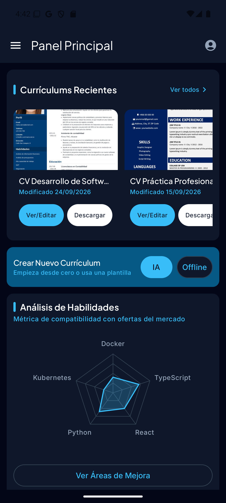
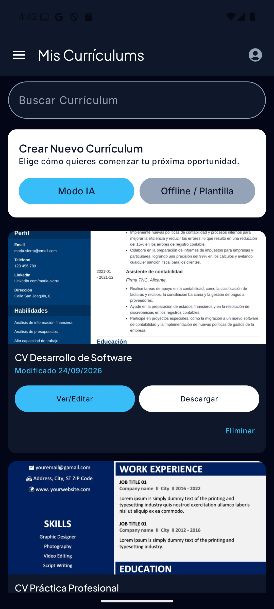
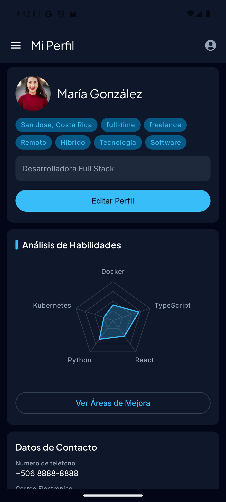
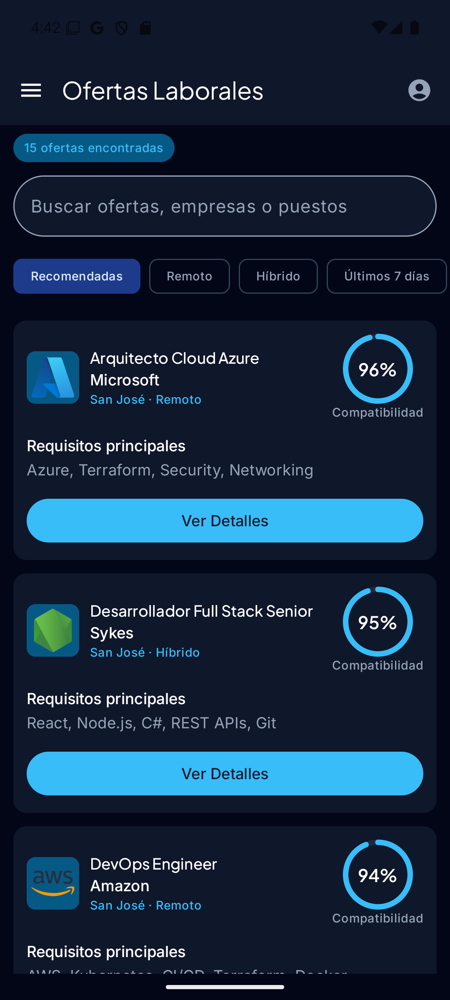
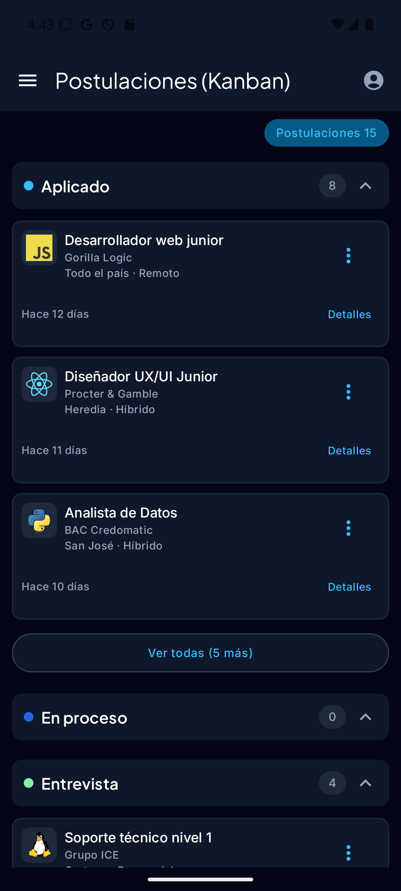
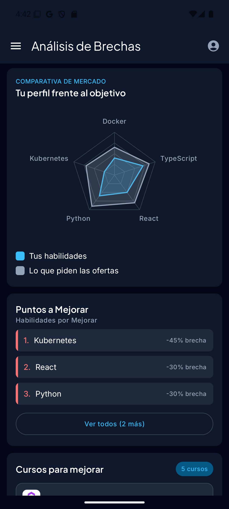
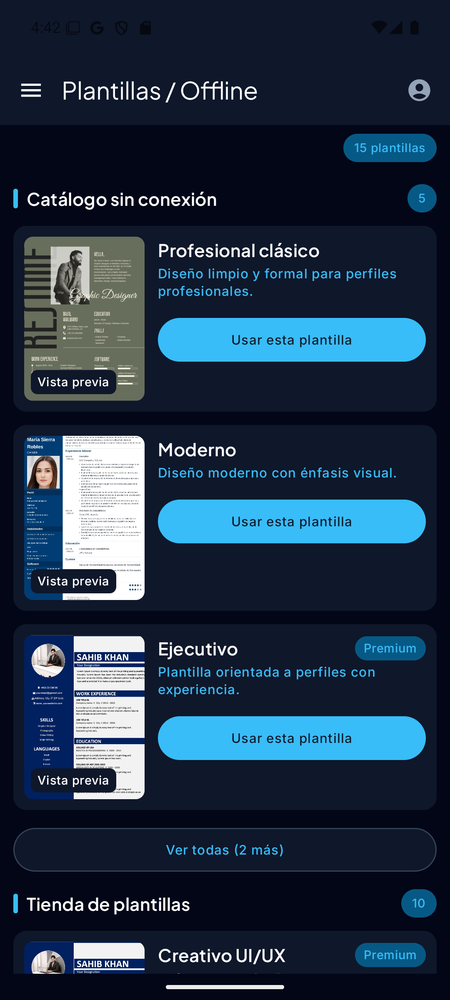
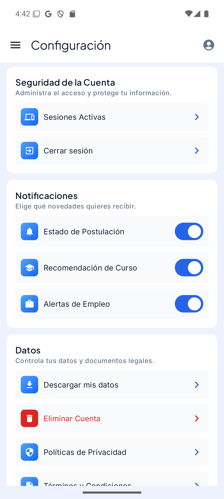
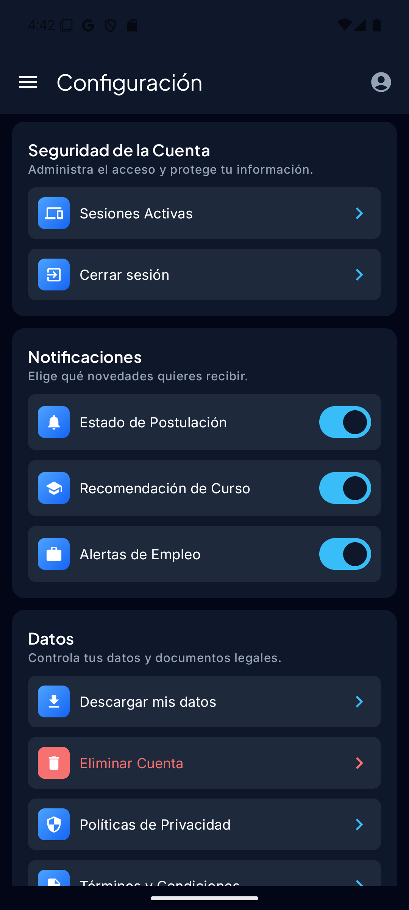

# CVExpert Mobile

Aplicación Android nativa de CVExpert, escrita en Kotlin con Jetpack Compose. Ayuda a jóvenes con poca experiencia laboral a armar su currículum, buscar ofertas, seguir sus postulaciones y ver la brecha entre sus habilidades y las que pide el mercado. Todo lo que muestra lo pide a Azure API Management (APIM).

- `applicationId`: `com.cvpro.app`
- `minSdk` 26, `targetSdk` y `compileSdk` 35
- Versión actual: 0.4.0 (`versionCode` 4)

## Origen del repositorio

Hasta la Fase I la app vivía en `apps/mobile` del monorepo [`cv-master`](https://github.com/SoftwareDesignTEC/cv-master). En la Fase II cada parte tiene su propio repositorio: uno para la web, este para la app y uno por cada microservicio.

Este repositorio se separó con `git filter-repo --subdirectory-filter apps/mobile`, así que conserva el historial, los autores y las fechas de todos los commits que tocaban la app. El keystore que estuvo una vez en la raíz de `cv-master` no forma parte de ese historial.

## Requisitos

- JDK 17 (el daemon de Gradle está fijado en Java 17 en `gradle/gradle-daemon-jvm.properties`).
- Android Studio o el Android SDK con la plataforma 35.

## Configuración local

La configuración se lee de `local.properties` en la raíz del repositorio. Ese archivo está en `.gitignore` y nunca se sube. Si una clave no está ahí, se toma de la variable de entorno con el mismo nombre, que es lo que hace la CI.

```properties
sdk.dir=<ruta del Android SDK>

# URL base de APIM. Se pide al encargado de APIM; no se escribe en el código.
APIM_BASE_URL=<URL base de APIM>

# Client ID web de Google (OAuth) para el inicio de sesión.
GOOGLE_WEB_CLIENT_ID=<client ID>

# Solo para generar un APK de release firmado en local.
RELEASE_KEYSTORE_PATH=release-key.jks
RELEASE_KEYSTORE_PASSWORD=<contraseña>
RELEASE_KEY_ALIAS=<alias>
RELEASE_KEY_PASSWORD=<contraseña>
```

`RELEASE_KEYSTORE_PATH` es relativa a la raíz del repositorio. El keystore no se versiona: se comparte por un canal directo y `.gitignore` bloquea `*.jks`.

## Compilar y correr

```bash
./gradlew assembleDebug        # APK de depuración en app/build/outputs/apk/debug/
./gradlew installDebug         # lo instala en el emulador o dispositivo conectado
./gradlew assembleRelease      # APK firmado, si están los cuatro datos RELEASE_* y el keystore
```

En Windows se usa `gradlew.bat` o Git Bash. Desde Android Studio basta con abrir la carpeta del repositorio.

## CI/CD

El workflow `.github/workflows/android-ci-cd.yml` corre en cada push y en cada pull request a `main`:

1. Compila el APK de release con JDK 17.
2. Solo en `main`, lo sube a Firebase App Distribution para el grupo `testers`.

Un push nuevo a la misma rama cancela la corrida anterior. El workflow necesita estos valores en Settings → Secrets and variables → Actions:

| Tipo | Nombre | Para qué |
| --- | --- | --- |
| Secret | `RELEASE_KEYSTORE_BASE64` | Keystore de release en base64 |
| Secret | `RELEASE_KEYSTORE_PASSWORD` | Contraseña del keystore |
| Secret | `RELEASE_KEY_ALIAS` | Alias de la llave |
| Secret | `RELEASE_KEY_PASSWORD` | Contraseña de la llave |
| Secret | `FIREBASE_SERVICE_CREDENTIALS` | JSON de la cuenta de servicio de Firebase |
| Variable | `APIM_BASE_URL` | URL base de APIM |
| Variable | `GOOGLE_WEB_CLIENT_ID` | Client ID web de Google |
| Variable | `FIREBASE_APP_ID` | App ID de Firebase |

Las tres últimas son Variables, no Secrets: el workflow las lee con `vars.` y, si se guardan como Secrets, llegan vacías y el APK sale sin servicio ni inicio de sesión.

La rama `main` está protegida: todo entra por pull request revisado por otra persona.

## Capturas de pantalla

Tomadas del emulador con la app corriendo contra los mocks de APIM, en tema oscuro; Configuración aparece en los dos temas.

| Pantalla | Captura |
| --- | --- |
| Panel principal |  |
| Mis currículums |  |
| Perfil |  |
| Ofertas laborales |  |
| Postulaciones |  |
| Análisis de brechas |  |
| Plantillas |  |
| Configuración |   |

## Documentación

- `docs/contract/models.ts`: modelos de datos compartidos con la web en la Fase I.
- `docs/licencias/`: licencias de las fuentes Inter y Plus Jakarta Sans.
